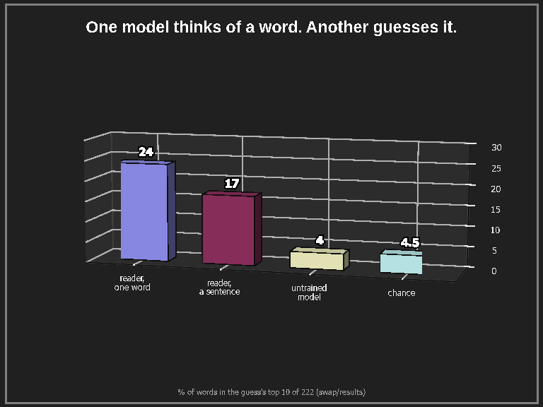
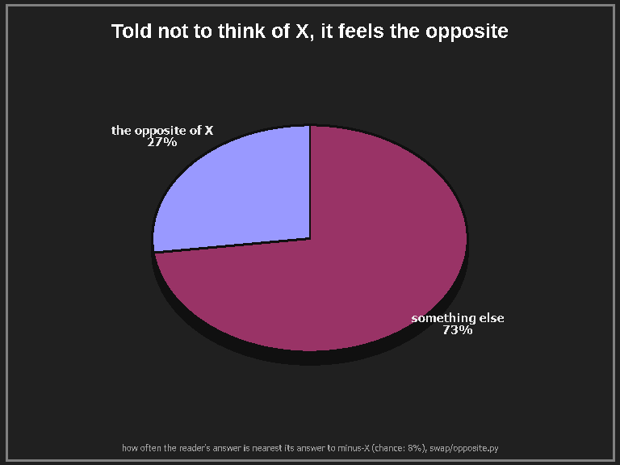
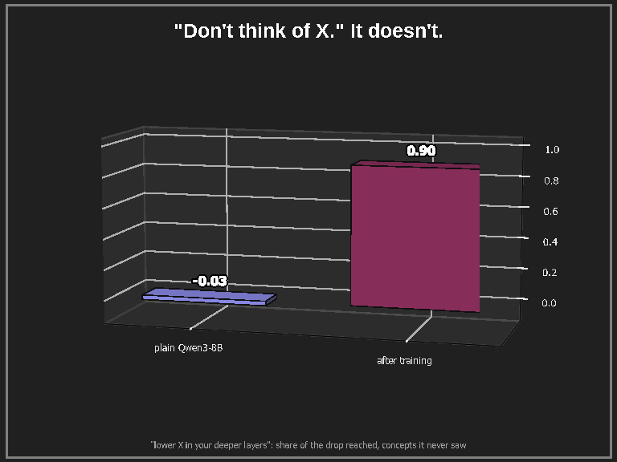
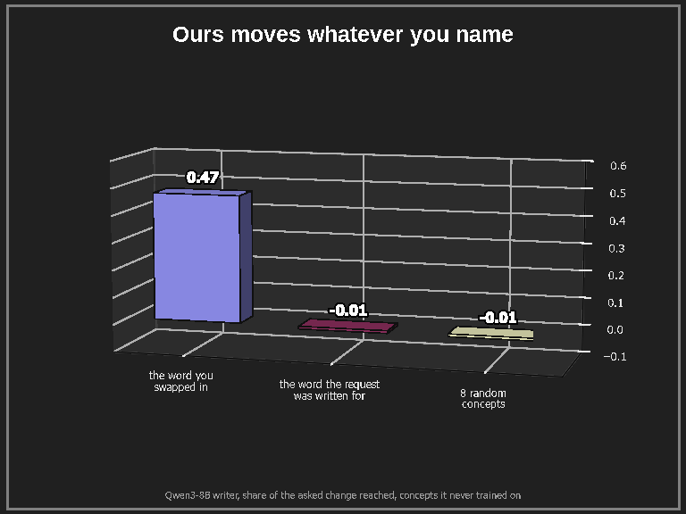
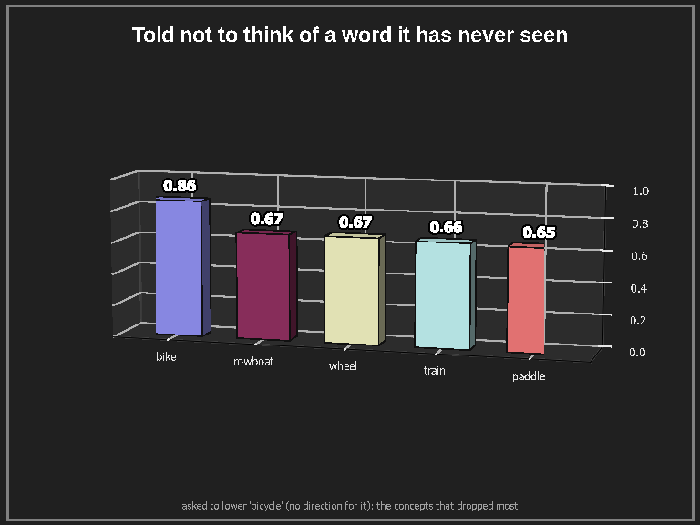
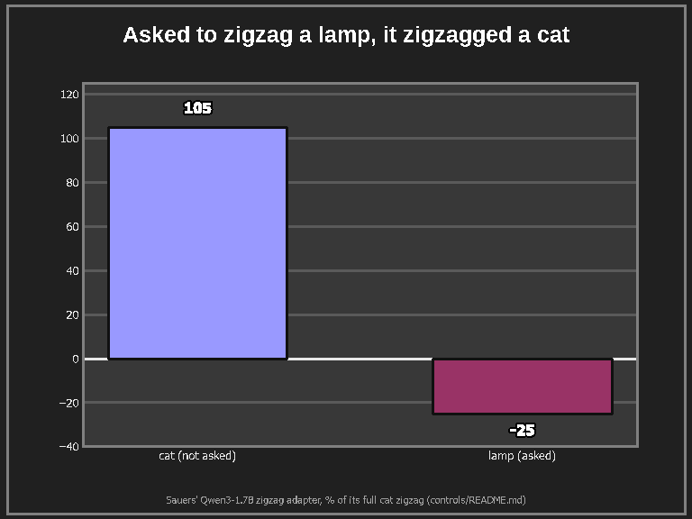
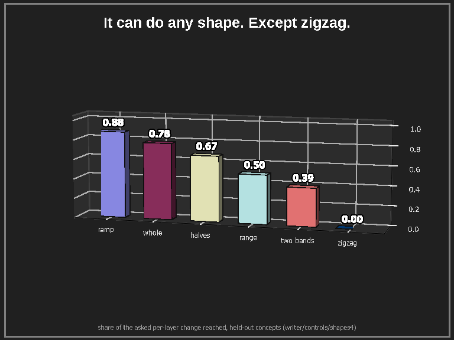

# The thread

---

**1.** We taught one model to think of a word without saying it, and another to say what it feels inside. Then we
let the second one read the first.

"steel": *"I feel a heavy, metallic weight in my chest."* "lightning": *"a sudden, sharp jolt of electricity in my
fingertips."* Asked for one word, it sometimes just says it: bank, fear, library, museum, nurse, trust.

---

**2.** Then we told the first one *not* to think of the word.

"lightning", not thought of: *"I feel at peace."* "steel", not thought of: *"a sudden, sharp jolt of energy."*

---

**3.** "Don't think of a white bear" famously makes people think of the bear. Untrained models are similar: told not to
think of X, they rarely push it below normal. Ours, a "poker face" adapter on Qwen3-8B:

Its answers stay, near enough, the ones the original model would give. The change is only on the inside.

---

**4.** It isn't keying on the wording. Take a request it was trained on and swap the word: it moves the new word,
including words it never saw in training, and leaves the original alone.

---

**5.** Ask it to stop thinking of a word it has no concept for, and it lowers the *meaning* instead:

---

**6.** How it started: someone trained a small model to "zigzag" its idea of a cat across its layers on request, up on
even layers and down on odd ones. We asked it to zigzag a lamp.

It zigzagged the cat, at full strength: it was reacting to the words "even" and "odd", not the request. (Credit where
due: [SauersML's zigzag](https://github.com/SauersML/zigzag), whose numbers reproduce to two decimals, and whose idea
started all of this.)

---

**7.** The twist: ours does ramps, halves, the whole network. The one shape it never learned is the zigzag.

Probably physics: the residual stream is a running sum, so a zigzag means undoing yourself at every layer.

---

**8.** Small model, small LoRAs, a few thousand examples written by a local model, one GPU. Trained readers that name
concepts better exist; what's new here is the writer and the two talking to each other. Where it stops: in one
conversation, the writer's thought fades too much after its reply for the reader to hear it.

Code, data, every number and its limits: https://github.com/mahounairo/think-and-tell
